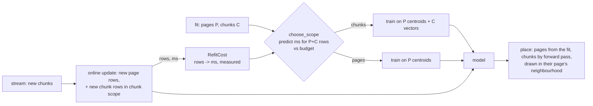

## Revised by the other face

- The first shape re-decided the scope on every online update. The api face:
  switching scope mid-epoch means the model's training rows change meaning
  under a live projection. The decision is per FIT (and the refit at 2x
  growth re-decides), updates only feed the cost model.
- The shape had chunk positions come straight from the fit's coordinates. The
  api face: `_place_chunks` already sends every chunk through `place`, and
  with a parametric model `place` IS the trained forward pass -- so the only
  change needed is WHAT is trained on; the placement path stays one path.
