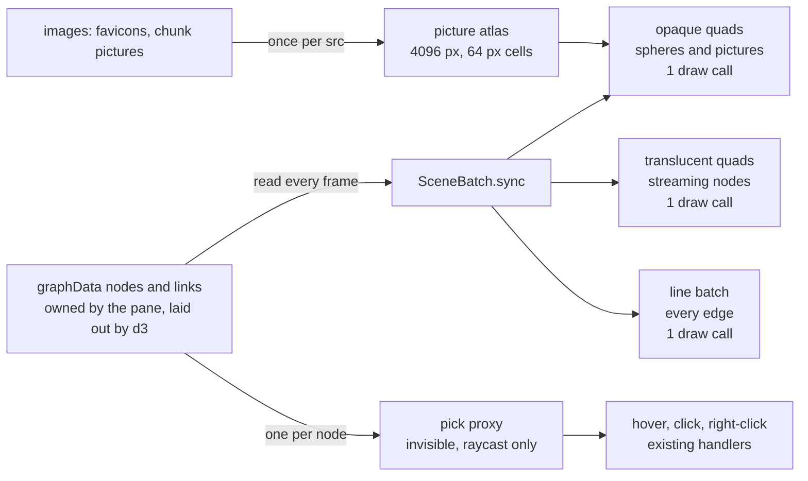
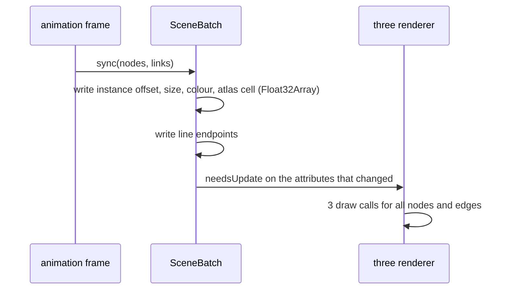

## What talks to what

## In what order, each frame

## State it holds

- per node: its instance slot (stable while the node exists); a free list for
  removed nodes so slots are reused without re-uploading everything.
- per picture src: its atlas cell; cells assigned once, the atlas re-uploaded at
  most every 100 ms however many images arrive.
- nothing about layout: positions and sizes are read, never stored.

## Revised by the other face

- **One mesh became two.** The first sketch drew every node in one instanced
  mesh. The api face: transparency is sorted per MESH, not per instance, so the
  translucent streaming spheres drawn among opaque ones either vanish behind
  them or occlude them wrongly. Streaming nodes got their own mesh, drawn after.
- **Points became quads.** The sketch said "a point per node". The api face:
  `gl_PointSize` is capped by the GPU (often 1,024 px, and ANGLE on Direct3D is
  the case here), so a node the camera flies close to would stop growing.
  Camera-facing quads have no such cap.
- **Pickers were added.** The shape had no per-node object at all; the api face
  showed 3d-force-graph picks by raycasting each node's own object, so every
  node keeps one -- invisible, never drawn.

## How this shape could be wrong

The hover ring and the fold tween are drawn on the per-node object today; if
either sets a visible material on the proxy it becomes a draw call again, and
the count creeps back with interaction.
